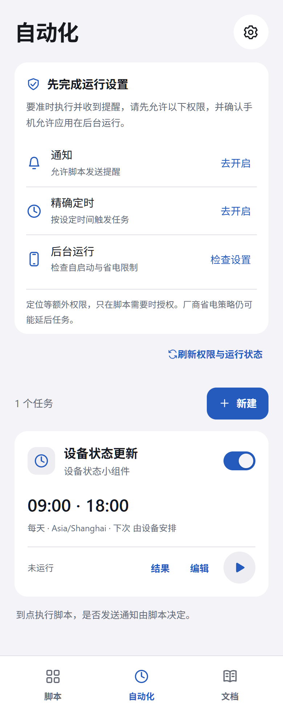

<div align="center">
  
  <h1>Scriptable Android</h1>
  <p>用 JavaScript 创建脚本、桌面小组件和定时自动化。</p>
  <p>
    <a href="https://github.com/awesome-sean/scriptable-android/releases/latest"></a>
    
    <a href="LICENSE"></a>
    <a href="https://github.com/awesome-sean/scriptable-android/stargazers"></a>
  </p>
  <p><a href="https://github.com/awesome-sean/scriptable-android/releases/download/v0.2.2/Scriptable-Android-0.2.2.apk"><strong>下载 APK · v0.2.2</strong></a> · <a href="docs/COMMUNITY_USAGE.txt">使用说明</a> · <a href="https://github.com/awesome-sean/scriptable-android/releases">版本记录</a></p>
</div>

本项目由 **awesome-sean** 基于 **[EdenleeGitHub/scriptable-android](https://github.com/EdenleeGitHub/scriptable-android) v0.2.1** 派生并维护，在上游基础上改进界面、定时自动化、桌面小组件和更新体验。保留原作者及贡献者的版权声明，继续使用 **[MIT 许可证](LICENSE)**。

上游是参照 [Scriptable 公开文档](https://docs.scriptable.app/) 实现的独立 Android 替代项目。本仓库是该项目的派生版本，并非从零开发；与 Scriptable、Apple 及上游作者没有官方隶属或合作关系，也不代表上游的官方发行。详细来源见 [上游与派生关系](UPSTREAM.md)。

## 下载与安装

适用于 **Android 8.0 及以上**。下载文件：**Scriptable-Android-0.2.2.apk**。

1. 点击上方下载链接，保存 APK，无需登录 GitHub、无需解压。
2. 打开 APK，按系统提示允许安装。
3. 启动 **Scriptable Android**，新建或导入 JavaScript 脚本。

## 功能与预览

- **脚本**：编写、导入和运行 JavaScript，查看运行结果。
- **自动化**：按每天设定的时间后台执行，支持多时段与时区。
- **桌面小组件**：展示脚本生成的内容，默认申请 2×2 大小。
- **检查更新**：打开应用自动提醒新版本，也可在设置中手动检查，由系统确认安装。

<p align="center"> </p>

<p align="center"> </p>

以上为代码界面预览，系统权限与安装界面因设备而异。

## 快速开始

### 运行脚本

点脚本页的 **＋** 新建，或点导入按钮选择 .js 文件。打开脚本后点“运行”，按需授予权限。编辑器支持自动换行、调整字号；拖动运行结果上方的横条可改变结果区高度。

### 设置定时自动化

1. 点底栏“自动化”，先完成页首的通知、精确定时和后台运行设置。
2. 点“新建”，选择脚本，填写执行时间、时区和可选参数。
3. 启用并保存。可用“运行一次”检查脚本，再查看最近结果。

定时任务不要求保持页面打开。省电、厂商后台限制、网络中断或强行停止应用可能延后或阻止运行。是否发通知由脚本决定；“已完成”表示执行结束，具体结果以脚本输出为准。

### 添加桌面小组件

运行包含 ListWidget 的脚本并生成预览，再添加到主屏幕。每个组件可单独选择脚本、参数和刷新设置；最终尺寸由手机桌面启动器决定。

[查看完整使用说明（TXT）](docs/COMMUNITY_USAGE.txt)

## 这次修改

- 统一明亮卡片、圆角菜单及深浅色界面，更新应用图标。
- 自动化与底栏直接切换，运行权限说明前置。
- 优化代码换行、字号调整和可拖动的运行结果区。

## 开发与构建

需要 JDK 17、Android SDK 36、Build Tools 35.0.0。

```sh
npm ci
npm test
npx playwright install chromium
npm run test:ui
./gradlew testDebugUnitTest assembleDebug lintDebug
```

发布版使用固定签名，签名材料不得提交到仓库或随 APK 分发。[发布说明](docs/COMMUNITY_RELEASE.md) · [修改记录](FORK_CHANGELOG.md)

## 来源与许可

基于 [EdenleeGitHub/scriptable-android](https://github.com/EdenleeGitHub/scriptable-android) **v0.2.1** 修改；派生维护者：awesome-sean。保留原作者和贡献者版权，沿用 **MIT 许可证**。本项目为独立派生版本，与上游维护者无官方合作关系。

- [MIT 许可证](LICENSE) · [第三方声明](THIRD_PARTY_NOTICES.md)
- [上游与派生关系](UPSTREAM.md) · [上游原始 README](docs/UPSTREAM_README.md)

应用的“关于 → 开源许可”包含原有许可证全文。包名保留为 dev.scriptable.android.community，已有数据目录不因显示名称变化而改变。
