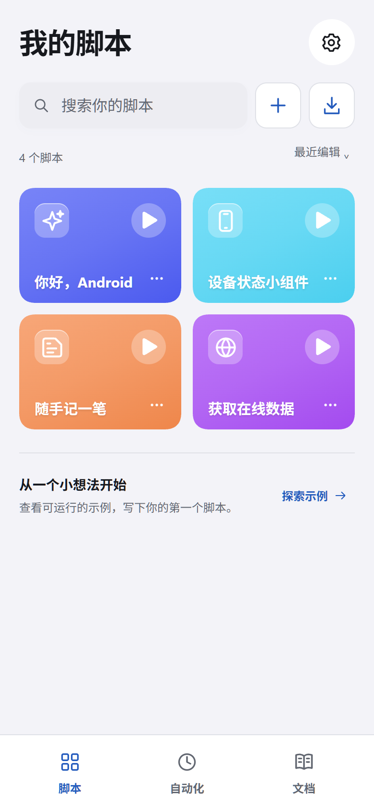
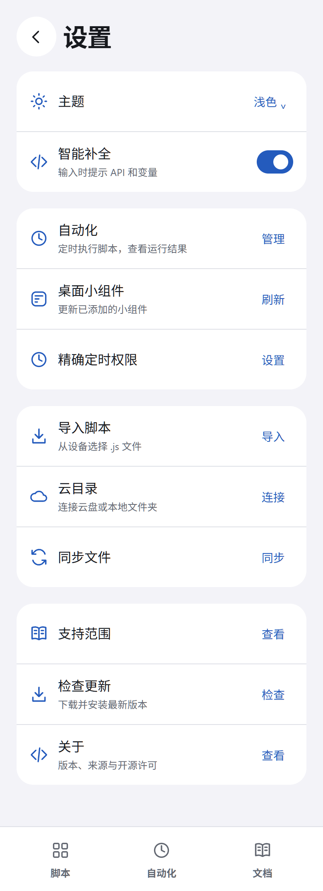
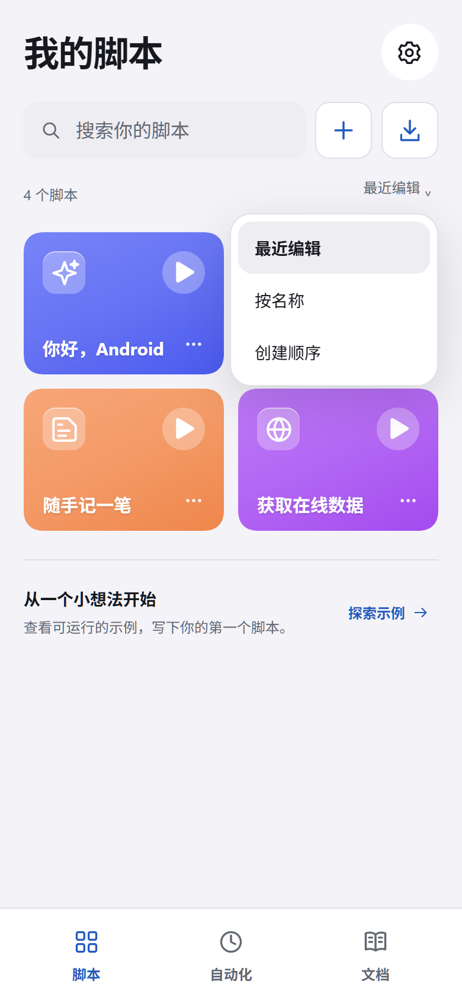
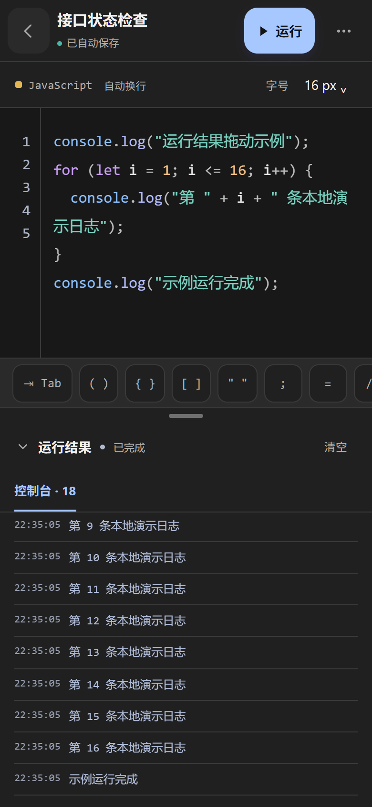

# Scriptable 社区版


## 下载与安装

### [点击下载安卓版 APK（0.2.2-dev 测试版）](https://github.com/awesome-sean/scriptable-android/raw/refs/heads/main/downloads/Scriptable-Community-0.2.2-dev-debug.apk)

**请下载这个文件：`Scriptable-Community-0.2.2-dev-debug.apk`。** 适用于 Android 8.0 及以上，安装后的应用名称为 **Scriptable 社区版**。

1. 在安卓手机上点击上面的下载链接，保存 APK，无需登录 GitHub、无需解压。
2. 打开下载的 APK，按系统提示允许安装并完成安装。
3. 打开“Scriptable 社区版”，按照 [简洁使用说明](docs/COMMUNITY_USAGE.txt) 导入脚本和配置自动化。

当前提供的是调试测试包，正式更新会另行发布。已安装旧调试包时，能否覆盖安装取决于签名是否一致。[下载文件校验值](downloads/SHA256.txt)

## 项目说明

基于 [EdenleeGitHub/scriptable-android](https://github.com/EdenleeGitHub/scriptable-android) **v0.2.1** 修改的 Android JavaScript 工具。上游基础提交：`20fac996b6f37f93230bd5e334cd5c86658c79e2`。派生维护者：awesome-sean。保留原作者与贡献者版权及 MIT 许可证，非上游官方发行版。

最新代码和预览以本仓库的 `main` 分支为准。版本 `0.2.2-dev`，包名 `dev.scriptable.android.community`，可与上游应用并存，两个应用的数据不自动互通。

<p> </p>

<p> </p>

以上为当前代码的浏览器预览，原生权限、自动化与系统安装需在 Android 上验收。

## 这次修改

- 统一圆角选择菜单，去除点击后的蓝色焦点框；浅色与深色页面保持一致。
- 编辑器支持自动换行、就地调整字号，运行结果上边缘可拖动调整高度。
- 自动化直接在底栏切换，权限与后台运行说明放在页首。


- 脚本页使用明亮渐变长方形卡片、柔和连续圆角、白色文字及半透明图标底；播放三角采用更圆润的边角，大小与透明圆底分别控制。
- 底栏为脚本、自动化、文档；选中项仅图标和文字变蓝。设置移至右上角，示例从“探索示例”进入。
- 设置、自动化、小组件配置和更新页采用统一的分组布局；版本、来源与许可集中在“关于”。
- 桌面小组件默认申请 **2×2**，默认内容尺寸为小。修复含弹性间隔的横向布局，按屏幕方向使用正确的启动器尺寸。已放置的小组件可能需删除后重新添加；最终格子大小仍由启动器决定。
- 新增每日多个固定时间、固定时区的脚本自动化，支持启停、编辑、删除、运行一次及查看最近结果。
- 新增检查更新、下载进度、取消/重试、APK 校验及系统安装入口。只接受本仓库正式 Release 的社区版安装包，安装需用户确认。

## 开始使用

[简洁使用说明（TXT）](docs/COMMUNITY_USAGE.txt)

1. 新建或导入 `.js` 脚本，先在前台运行并完成所需权限授权。
2. 点底栏“自动化”→“新建自动化”，选择脚本、运行时间、时区和参数，打开“启用定时执行”并保存。
3. 在自动化页允许通知与精确定时，并按设备要求允许后台运行。可点“运行一次”，稍后“刷新运行结果”。

后台由 AlarmManager 唤醒并交给 JobScheduler 执行，不要求保持页面打开。系统省电、厂商后台限制、网络中断或强行停止仍可能延后或阻止运行。重启、覆盖安装、时间/时区变化后重新安排；重启恢复时仅补执行 15 分钟内错过的任务。执行最长 90 秒；不自动重试已经开始的任务，以免重复通知。“已完成”表示脚本已结束，具体结果见脚本输出。

## 更新与发布

用户在右上角设置→“检查更新”操作。当前更新源为本 Fork，**不会安装上游 APK**；尚无正式 Release 时会明确显示未发布。

维护者发布要求见 [docs/COMMUNITY_RELEASE.md](docs/COMMUNITY_RELEASE.md)：递增版本号和 versionCode，沿用固定签名，上传名为 `scriptable-community-release.apk` 的正式安装包。检查更新不会把每次 CI 的调试构建当作正式更新。

## 验证与构建

```sh
npm ci
npm test
npx playwright install chromium
npm run test:ui
./gradlew testDebugUnitTest assembleDebug lintDebug
```

需要 JDK 17、Android SDK 36、Build Tools 35.0.0。GitHub Actions 会执行这些检查并保存调试 APK 和报告。调试包用于验收，不作为正式更新源。详细验证状态见 [FORK_CHANGELOG.md](FORK_CHANGELOG.md)；发布前仍需在真机验证锁屏、重启、厂商后台限制及覆盖更新。

本次代码构建已通过：123 项运行时测试、全部浏览器检查、25 项原生回归、lint、APK 资源一致性校验。可查看 [成功的构建记录](https://github.com/awesome-sean/scriptable-android/actions/runs/45028661820) 或下载其 [调试 APK 与报告](https://github.com/awesome-sean/scriptable-android/actions/runs/45028661820/artifacts/14756542806)。

## 来源与许可

- [原始 MIT 许可证](LICENSE)，保留 `Copyright (c) 2026 EdenleeGitHub and contributors`。
- [上游与派生关系](UPSTREAM.md)、[第三方声明](THIRD_PARTY_NOTICES.md)。
- [上游原始 README](docs/UPSTREAM_README.md)，其中上游发行链接及验证结果不代表本派生版的验证状态。
- APK 的“关于→开源许可”包含上游 MIT 全文和第三方许可。本 Fork 新增和修改代码同样按 MIT 提供。

本项目与 Scriptable、Apple 或上游维护者没有官方合作关系。
